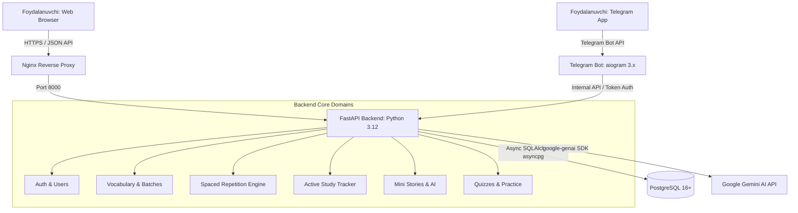
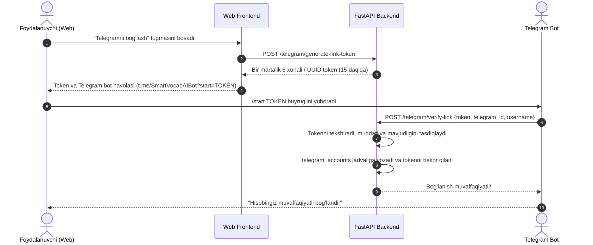
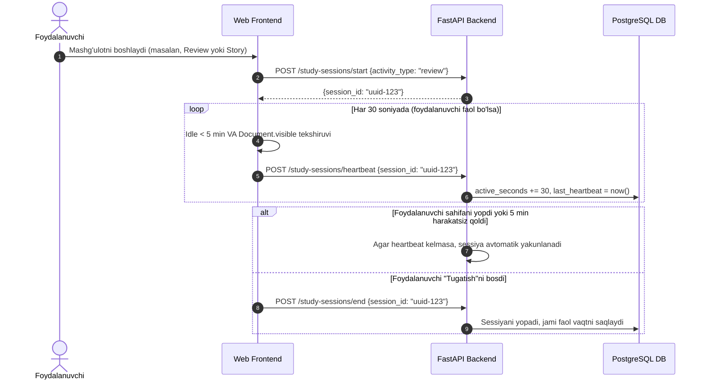
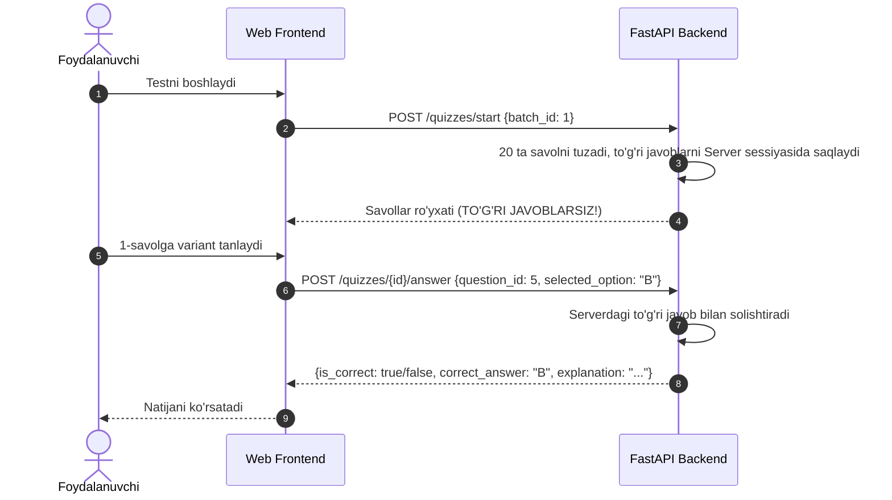

# SmartVocab AI — Arxitektura Hujjati (ARCHITECTURE.md)

**Versiya:** 1.0.0  
**Holati:** Tasdiqlangan  

---

## 1. Tizimning umumiy arxitekturasi

SmartVocab AI — zamonaviy, asinxron mikroxizmatlarga mos, lekin monolit darajasida oson boshqariladigan modulli arxitekturaga ega. Barcha mijozlar (Veb-ilova va Telegram bot) yagona RESTful API va umumiy PostgreSQL ma'lumotlar bazasi orqali ma'lumotlarni almashadi.



---

## 2. Asosiy komponentlar va ularning chegaralari

### 2.1 Frontend (Veb-ilova)
- **Texnologiya:** React 18, TypeScript, Vite, Tailwind CSS, TanStack Query, Framer Motion.
- **Mas'uliyati:** Foydalanuvchiga yuqori darajadagi interfeysni taqdim etish, so'zlarni interaktiv ko'rsatish, audio tinglash, brauzer faolligini kuzatish (Visibility & Activity API), animatsiyalar va form validatsiyasi.
- **Cheklov:** Baholash (scoring) va xavfsizlik qarorlari frontendda qabul qilinmaydi.

### 2.2 Backend (FastAPI API)
- **Texnologiya:** Python 3.12, FastAPI, Pydantic v2, SQLAlchemy 2.0 (async), Alembic.
- **Mas'uliyati:** Biznes mantiq, foydalanuvchilar autentifikatsiyasi, so'zlar va to'plamlar boshqaruvi, SRS algoritmi hisob-kitoblari, faol vaqt audit va agregatsiyasi, AI so'rovlarini boshqarish va xavfsiz test tekshiruvi.

### 2.3 Telegram Bot
- **Texnologiya:** Python 3.12, aiogram 3.x, aiohttp / httpx.
- **Mas'uliyati:** Telegram orqali qulay interfeys yaratish (inline tugmalar, xabarlar), foydalanuvchi hisobini xavfsiz bog'lash, kunlik eslatmalar yuborish, qisqa takrorlash testlarini taqdim etish.
- **Cheklov:** Telegram bot o'zining alohida ma'lumotlar bazasiga ega emas; barcha operatsiyalarni FastAPI API orqali amalga oshiradi.

### 2.4 Google Gemini AI Integratsiyasi
- **Texnologiya:** `google-genai` SDK, Pydantic Structured Output.
- **Mas'uliyati:** So'zlarning kontekstli tarjimalari, misol gaplar, A1–C2 darajadagi mini hikoyalar, savollar va tushuntirishlarni yaratish.
- **Boshqaruv:** So'rovlar keshlanadi, xatolar ushlanadi (bounded retries), model nomi muhit o'zgaruvchisida sozlanadi.

---

## 3. Backend modulli tuzilishi (Domain-Driven)

```text
backend/app/
├── api/
│   ├── v1/
│   │   ├── endpoints/
│   │   │   ├── auth.py          # Kirish, ro'yxatdan o'tish, tokenni yangilash
│   │   │   ├── users.py         # Profil, sozlamalar, maqsadlar
│   │   │   ├── vocabulary.py    # So'zlar CRUD, qidiruv, filtr
│   │   │   ├── batches.py       # To'plamlar boshqaruvi (20 talik)
│   │   │   ├── imports.py       # TXT, CSV, XLSX import qilish va preview
│   │   │   ├── reviews.py       # Kunlik SRS takrorlash navbati va submit
│   │   │   ├── quizzes.py       # Test sessiyalari va javoblarni tekshirish
│   │   │   ├── stories.py       # Mini hikoyalar yaratish va o'qish
│   │   │   ├── study_time.py    # Faol vaqt sessiyalari va heartbeat
│   │   │   ├── analytics.py     # Rivojlanish ko'rsatkichlari, streak
│   │   │   └── telegram.py      # Bot uchun maxsus va linking endpointlar
│   │   └── router.py            # Barcha yo'nalishlarni yig'uvchi router
├── core/
│   ├── config.py                # Pydantic Settings
│   ├── database.py              # Async Engine va SessionLocal
│   └── security.py              # Password hashing, JWT yaratish va tekshirish
├── models/                      # SQLAlchemy 2.x deklarativ modellari
├── schemas/                     # Pydantic v2 so'rov va javob sxemalari
└── services/                    # Biznes mantiq qatlami
    ├── srs_service.py           # Interval takrorlash algoritmi (SM-2 / FSRS)
    ├── import_service.py        # Fayllarni tahlil qilish va to'plamlarga ajratish
    ├── ai_service.py            # Gemini API bilan aloqa va validatsiya
    ├── study_tracker.py         # Vaqtni hisoblash va tekshirish mantiqi
    └── quiz_service.py          # Savollarni tuzish va tekshirish
```

---

## 4. Ma'lumotlar oqimi va asosiy jarayonlar

### 4.1 Telegram hisobini xavfsiz bog'lash (Account Linking)


### 4.2 Faol o'rganish vaqtini kuzatish (Active Study-Time Tracking)


### 4.3 Anti-Cheat Test topshirish oqimi (Quiz Integrity)


---

## 5. Spaced Repetition (SRS) algoritmi

SmartVocab AI SuperMemo SM-2 algoritmining zamonaviy optimallashtirilgan variantidan foydalanadi:
- **Repetition Number ($n$):** So'zning ketma-ket necha marta to'g'ri eslangani.
- **Ease Factor ($EF$):** Boshlang'ich qiymat: 2.5 (minimal: 1.3).
- **Interval ($I$):**
  - $I(1) = 1$ kun
  - $I(2) = 6$ kun
  - $I(n) = I(n-1) \times EF$
- Har bir javob berilganda foydalanuvchi bahosi (Quality 0 dan 5 gacha) olinadi. Agar foydalanuvchi xato qilsa (Quality < 3), $n = 0$ qilinadi va interval 1 kunga qaytadi. So'z butunlay "yodlangan" deb kamida 5 marta to'g'ri takrorlangandan so'ng hisoblanadi.
